# Nomily AI

> **Recorder → Nomily AI → Your API Key → Your AI**

<p align="center">
  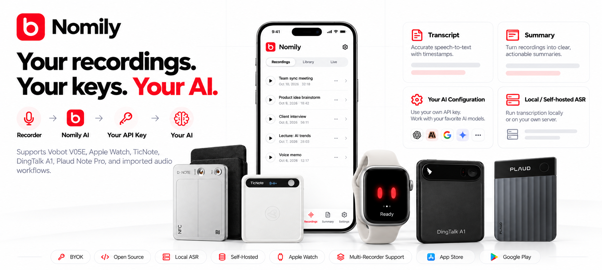
</p>

<p align="center">
  <a href="https://github.com/Nomily-Ai/nomily-ios"></a>
  <a href="https://github.com/Nomily-Ai/nomily-android"></a>
  <a href="https://geekis.com"></a>
  <a href="https://apps.apple.com/us/app/nomily-ai/id6811033606"></a>
  <a href="https://discord.gg/uQFj3Rfv54"></a>
  <a href="LICENSE"></a>
</p>

<p align="center">
  <a href="README.md">English</a> · <a href="README.zh-CN.md">简体中文</a> · <a href="README.zh-TW.md">繁體中文</a>
</p>

**BYOK voice-recording companion for Vobot V05E, Plaud Note Pro, DingTalk A1, TicNote,
soundcore Work (D3200), Apple Watch, and iPhone imports —
ASR transcription, speaker diarization, AI summaries, and local ASR endpoint
support.**

Nomily AI brings recordings into a native client, transcribes them with a provider
you configure, and generates a summary with an AI provider you choose.

This repository is the project entry point. The runnable native clients live in
[`nomily-ios`](https://github.com/Nomily-Ai/nomily-ios) and
[`nomily-android`](https://github.com/Nomily-Ai/nomily-android).

## Quick links

| 📱 iPhone app | 🤖 Android app | 🌐 Online demo | 🎥 Video demos | 𝕏 Updates | 💬 Discord | 📚 Documentation |
|---|---|---|---|---|---|---|
| [Download on the US App Store](https://apps.apple.com/us/app/nomily-ai/id6811033606) | [Get it on Google Play](https://play.google.com/store/apps/details?id=com.nomily.app) | [Try the fixed-data preview](https://geekis.com/demo/) | [Nomily AI on YouTube Shorts](https://www.youtube.com/@Nomily-Ai/shorts) | [@nomilyai](https://x.com/nomilyai) | [Join the community](https://discord.gg/uQFj3Rfv54) | [Geekis.com](https://geekis.com) |

## Choose your path

| Build or need | Start here |
| --- | --- |
| Build for iPhone or Apple Watch | [nomily-ios](https://github.com/Nomily-Ai/nomily-ios) |
| Install Nomily AI on iPhone | [Download on the US App Store](https://apps.apple.com/us/app/nomily-ai/id6811033606) |
| Install Nomily AI on Android | [Get Nomily AI on Google Play](https://play.google.com/store/apps/details?id=com.nomily.app). |
| Build for Android | [nomily-android](https://github.com/Nomily-Ai/nomily-android) |
| Explore the workflow without a device, key, or upload | [Try the fixed-data demo](https://geekis.com/demo/) |
| Get help, report a documentation issue, or ask about licensing | [SUPPORT.md](SUPPORT.md) · [nomily@geekis.com](mailto:nomily@geekis.com) |

This repository is not an installable client or a Docker deployment. Read the
client-specific build instructions before starting a local build.

## Project navigation

- [Architecture and integration boundary](ARCHITECTURE.md): exact client,
  device, provider, and local-ASR boundaries.
- [Public roadmap](ROADMAP.md): what is available, in progress, or only under
  evaluation.
- [Agent guide](AGENTS.md) · [LLM navigation](llms.txt): concise project map
  for code agents and other machine readers.

## What is Nomily AI?

Nomily AI is not a hosted transcription account or a shared recording cloud. It is
a native companion workflow for recordings and user-configured AI services. The
app keeps the choice of transcription and summary provider with the user.

The public repositories provide source for inspection and local builds. Store
availability may vary by storefront and version; source commits do not promise
device/firmware compatibility or a production service release.

## What it does today

- Connects to the V05E BLE recorder workflow, downloads recordings, and manages
  a local recordings library.
- Imports recordings on iPhone, including recordings transferred from the Apple
  Watch companion.
- Transcribes live or recorded audio through Azure Speech or a user-operated
  local faster-whisper-compatible ASR endpoint; Azure transcription enables
  speaker diarization for up to 10 speakers.
- Generates summaries, titles, and translations with a configured LLM provider:
  OpenAI, Anthropic, Gemini, OpenRouter, Ollama, or a custom OpenAI-compatible
  endpoint.
- Provides native iOS / Apple Watch and Android implementations rather than a
  cross-platform wrapper.

## Privacy and provider boundaries

Nomily AI is not a hosted transcription account or a shared recording cloud. API
keys are supplied by the user and must never be committed. Keep recordings,
transcripts, device identifiers, logs, generated configuration files, and access
credentials out of issues and pull requests.

Nomily AI does not charge a subscription fee. Third-party ASR and LLM costs are
paid separately under the selected provider's pricing.

| Service layer | Data sent in a configured workflow | Who provides it |
|---|---|---|
| Nomily AI client | Recording library, transfer state, and generated files on the client | You install and operate the client. |
| Azure Speech | Audio for transcription, when Azure is selected | Your Azure account and key. |
| Local ASR endpoint | Audio for transcription, when a local endpoint is selected | You operate the endpoint. |
| LLM provider | Transcript text needed for summary, title, or translation | Your selected provider, model, endpoint, and key. |

The public repositories do not include a shared Nomily AI cloud, a bundled provider
account, or a complete self-hosted sync stack. Local ASR and Ollama are
provider integrations, not a claim that every product layer is self-hosted.

## How it works

```text
Vobot V05E recorder / Plaud Note Pro / DingTalk A1 / TicNote / soundcore Work (D3200) / Apple Watch / audio imported on iPhone
                  │
                  ▼
        Nomily AI native client
  local library · transfer · playback
                  │
        ┌─────────┴──────────┐
        ▼                    ▼
Azure Speech or        Your LLM provider
local ASR endpoint     summary · title · translation
diarization when       OpenAI · Anthropic · Gemini
Azure is selected      OpenRouter · Ollama · compatible endpoint
        │                    │
        └─────────┬──────────┘
                  ▼
         Transcript and summary
```

<p align="center">
  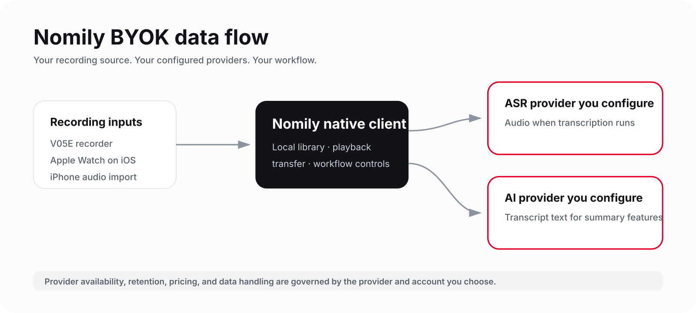
</p>

## Advanced: run ASR and an LLM on your own network

This is an optional advanced setup, not a complete self-hosted Nomily stack.
Run both services on a trusted computer on the same private Wi-Fi as the phone;
do not expose either service to the public internet.

### 1. Local Whisper transcription

The included reference service implements the exact Local ASR Server contract:
WebSocket port `12300` for live audio and HTTP port `12301` for recording files.
It needs Python 3.10+ and `ffmpeg` (`brew install ffmpeg` on macOS, or
`sudo apt install ffmpeg python3-venv` on Ubuntu/Debian).

```bash
git clone https://github.com/Nomily-Ai/nomily-app.git
cd nomily-app/examples/local-asr-server
python3 -m venv .venv && source .venv/bin/activate
pip install -r nomily_local_asr/requirements.txt
python -m nomily_local_asr --host 0.0.0.0 --port 12300 --http-port 12301 --model small --lang auto
```

The first run downloads the Whisper model. Follow the complete
[local ASR reference guide](examples/local-asr-server/README.md), including a
local `curl` test and firewall notes. For a guided local installation, copy
the [English AI-agent deployment prompt](examples/local-asr-server/AI_AGENT_SETUP_PROMPT.md)
into an agent running on the computer that will host the services.

### 2. Local Ollama summaries

Install Ollama from [ollama.com/download](https://ollama.com/download/), then
download a model:

```bash
ollama pull qwen3:8b
# Linux foreground service; bind to LAN only when the phone must reach it.
OLLAMA_HOST=0.0.0.0:11434 ollama serve
```

If Ollama is managed by its desktop app or a service manager, set its
`OLLAMA_HOST` environment variable to `0.0.0.0:11434` and restart that service.
This makes it reachable on the LAN; it does not add authentication.

### 3. Find the computer address and fill in Nomily AI

Keep the phone and computer on the same Wi-Fi, then run one of these commands:

```bash
# macOS
ipconfig getifaddr en0
# Linux
hostname -I
```

If the computer prints `192.168.1.20`, enter the following in the phone app:

| Nomily AI screen | Field | Value to enter |
| --- | --- | --- |
| **Settings -> ASR providers -> Local ASR Server** | Host | `192.168.1.20` |
| | Port | `12300` |
| **Settings -> LLM providers -> Ollama** | Endpoint URL | `http://192.168.1.20:11434` |
| | Model | `qwen3:8b` (or a model returned by Verify) |

Do not use `localhost` or `127.0.0.1` in the phone app: those addresses point
to the phone, not to the computer. The ASR client automatically sends complete
files to port `12301`. Allow inbound LAN connections to ports `12300`, `12301`,
and `11434` only when the corresponding service is running.

## Recording input support

| Input | Current source status | Notes |
|---|---|---|
| Vobot V05E recorder | Implemented in both clients | Primary BLE recording input; compatibility still depends on the actual device and firmware under test. [View on Amazon](https://www.amazon.com/dp/B0HHGWYS6J?maas=maas_adg_7561A19815A1FBF370F5F7E1AAD78D3E_afap_abs&ref_=aa_maas&tag=maas) |
| Plaud Note Pro | Supported through iPhone audio import | Export a recording from the device, then import it into Nomily AI for library, transcription, and summary workflows. This does not imply direct BLE pairing. |
| soundcore Work (D3200) / Anker AI Recorder Bean | Supported through iPhone audio import | Export a recording from the device, then import it into Nomily AI for library, transcription, and summary workflows. This does not imply direct BLE pairing. |
| DingTalk A1 | Supported through iPhone audio import | Export a recording from the device, then import it into Nomily AI for library, transcription, and summary workflows. This does not imply direct BLE pairing. |
| TicNote | Supported through iPhone audio import | Export a recording from the device, then import it into Nomily AI for library, transcription, and summary workflows. This does not imply direct BLE pairing. |
| Apple Watch microphone | Implemented in `nomily-ios` | The watchOS companion records on Watch and transfers recordings to the paired iPhone client. |
| Audio imported on iPhone | Implemented in `nomily-ios` | iPhone is an import, management, transcription, and summary client. |
| Other recorder models | Not committed | A model is not supported merely because it can record audio. |
| Android Watch companion | Not published | Do not infer a Wear OS client from the Android app source. |

<p align="center">
  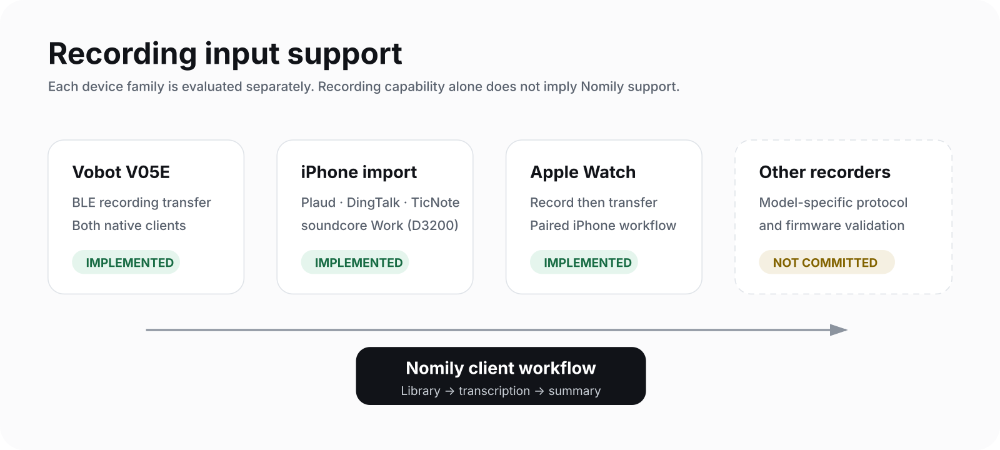
</p>

See the expandable [device compatibility matrix](media/devices/README.md)
before assuming a recorder model is supported.

## Apple Watch companion

After Nomily AI is installed on the paired iPhone, install its Watch companion:

1. Open the **Watch** app on iPhone and scroll to **Available Apps**.
2. Find **Nomily AI** and tap **Install**.
3. In Nomily AI on iPhone, open **Settings → Apple Watch** and confirm it shows
   **Installed**.
4. Open Nomily AI on Apple Watch and record when V05E is not with you. The
   recording syncs to the iPhone Nomily AI app for transcription, organization,
   and summaries.

| Install from Watch App | Confirm in Nomily AI settings | Record on Apple Watch |
|---|---|---|
| 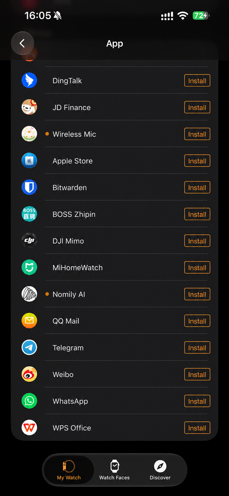 | 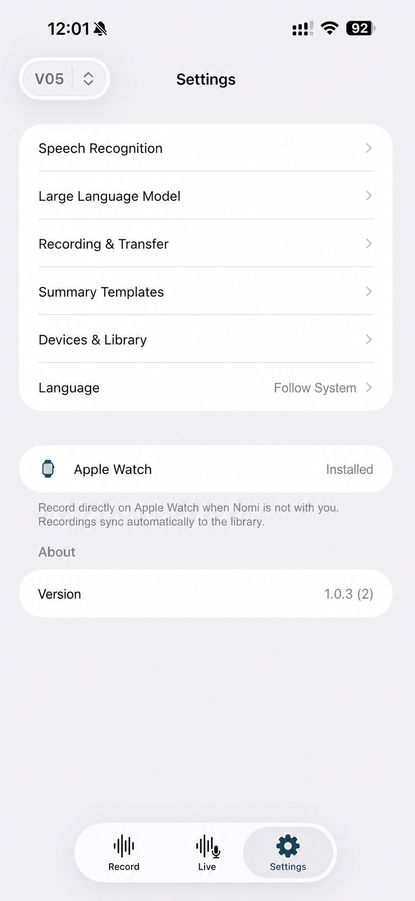 | 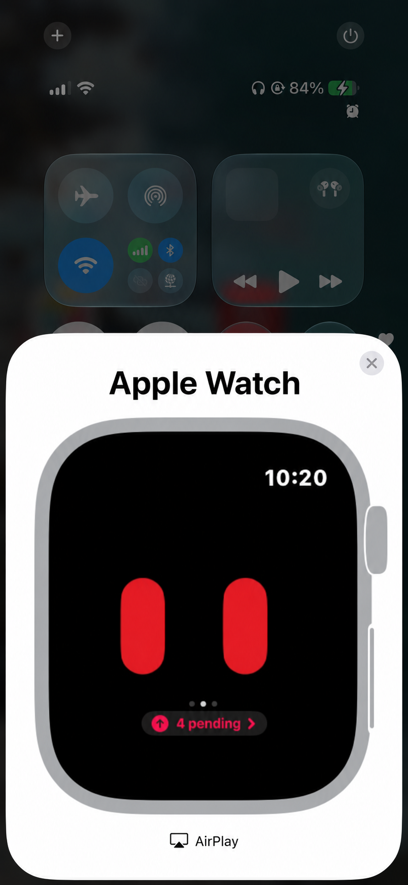 |

### Planned or not published

| Item | Status |
|---|---|
| Other recorder models and protocols | Compatibility is not committed until tested with the relevant firmware. |
| Android Watch companion | Not published. |
| RAG, MCP, shared self-hosted sync | Not represented by the current public client source; not an announced capability. |
| Online no-key demo | A fixed-data preview is live at [Geekis.com/demo](https://geekis.com/demo/). It does not upload audio, call ASR or LLM services, or store keys. |

## Repository map

| Repository | Role | Relationship |
|---|---|---|
| **nomily-app** | Project entry, cross-project documentation, licence, and preview assets | Start here. It does not contain an installable client by itself. |
| [`nomily-ios`](https://github.com/Nomily-Ai/nomily-ios) | SwiftUI client for iPhone and Apple Watch | Its own native project, build instructions, and issue tracker. |
| [`nomily-android`](https://github.com/Nomily-Ai/nomily-android) | Kotlin / Jetpack Compose client for Android | Its own native project, build instructions, and issue tracker. |
| `nomily-site` | Private static-site deployment source | Hosts setup and demo material; it is not a mobile-client source repository. |

## Build and project layout

The clients share product concepts and protocol expectations, but are separate
native implementations. Review the relevant repository before choosing a build
path:

```text
nomily-app/       project map, licence, public preview assets
nomily-ios/       iOS app, Watch companion, BLE / ASR / local library modules
nomily-android/   Android app and core protocol, crypto, audio, ASR, LLM modules
nomily-site/      private static deployment source for guides and the demo
```

| Goal | Start here |
|---|---|
| Build for iPhone or Apple Watch | [`nomily-ios`](https://github.com/Nomily-Ai/nomily-ios) — macOS, Xcode 15+, and a physical iPhone; Apple Watch optional. |
| Build for Android | [`nomily-android`](https://github.com/Nomily-Ai/nomily-android) — JDK 21, Android Studio or Gradle, and a physical Android phone. |
| Report a defect | Open an issue in the affected native-client repository with redacted reproduction steps. |
| Need support or have a project-entry question | Read [SUPPORT.md](SUPPORT.md) or email [nomily@geekis.com](mailto:nomily@geekis.com). |
| Review terms | Read the [Nomily Small Team License](LICENSE). |

## App preview

| Recordings | Transcription providers | LLM providers for summaries |
|---|---|---|
| 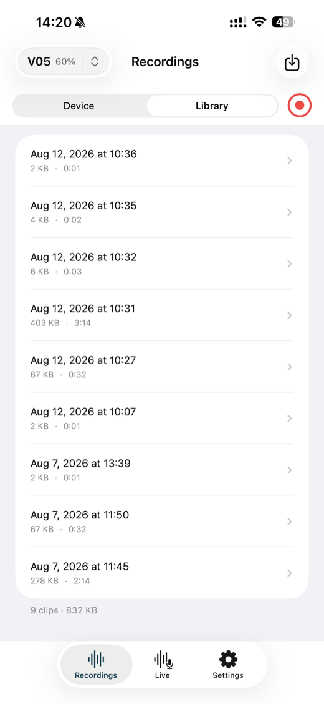 | 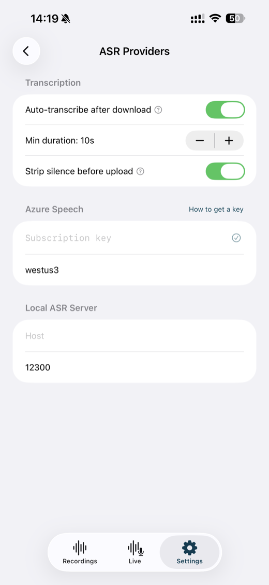 | 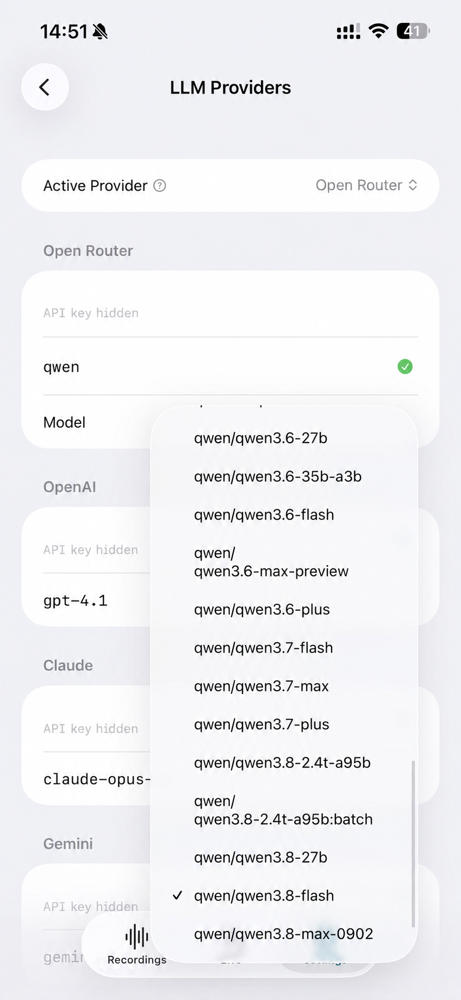 |

Screens use synthetic or non-sensitive preview data. Review
[`media/README.md`](media/README.md) before reusing product imagery or brand
assets.

### Android workflow gallery

| Recording detail | ASR configuration | LLM configuration | Summary templates |
|---|---|---|---|
| 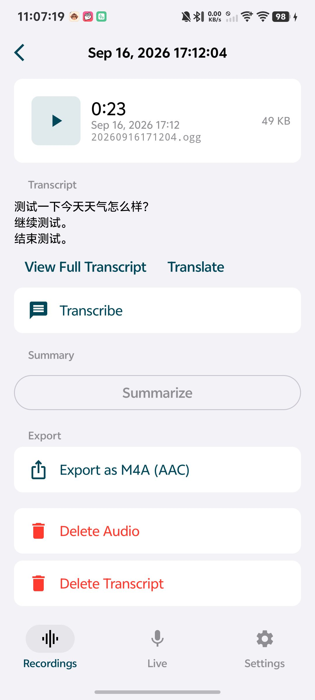 | 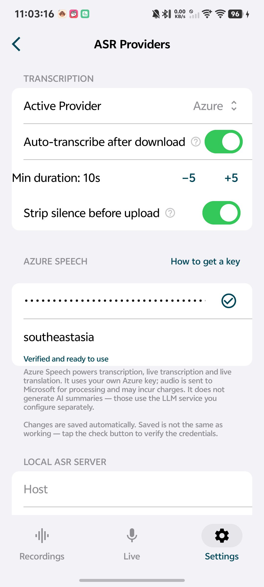 | 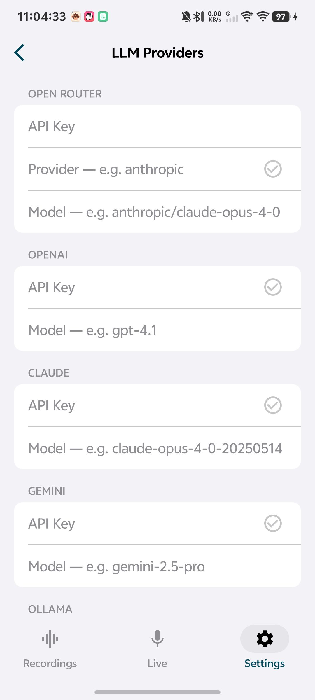 | 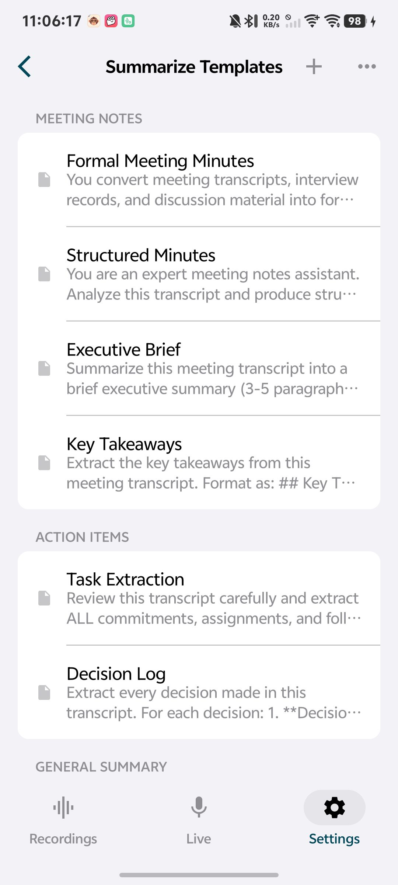 |

These screenshots use non-sensitive preview data. They show the Android client
workflow and do not promise provider availability, device compatibility, or
store release availability.

## Licence

The source is available under the [Nomily Small Team License 1.0.0](LICENSE).
It permits personal use and company use by teams of up to 10 people; larger
teams need a separate paid licence. Contact <nomily@geekis.com> for commercial
licensing. This is a source-available licence, not an OSI-approved open-source
licence.

Brand assets under [`media/`](media/) are excluded from that licence; see
[`media/README.md`](media/README.md).

## Community and security

### Join the Nomily AI Discord

Ask setup questions, share feedback, and meet other Nomily users in the
[Nomily AI Discord community](https://discord.gg/uQFj3Rfv54).

Read [CONTRIBUTING.md](CONTRIBUTING.md) before proposing a change. For general
help, use [SUPPORT.md](SUPPORT.md). Report vulnerabilities privately according
to [SECURITY.md](SECURITY.md), never in a public issue.

## Star history

[](https://www.star-history.com/#Nomily-Ai/nomily-app&type=date&legend=top-left)
